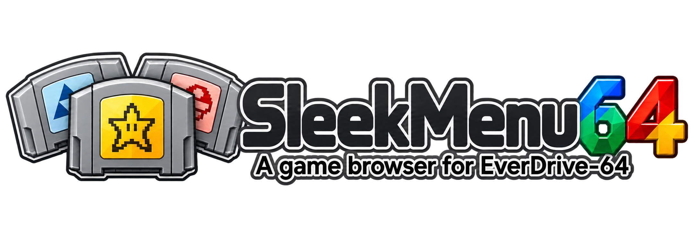
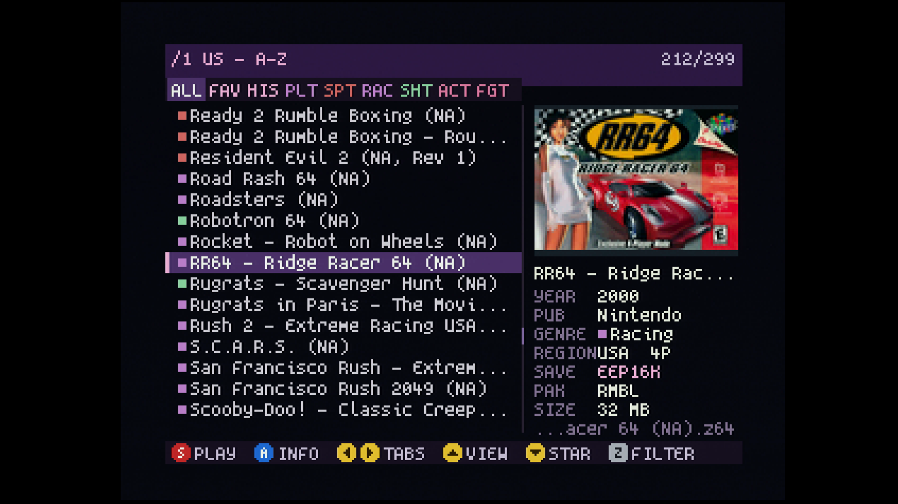
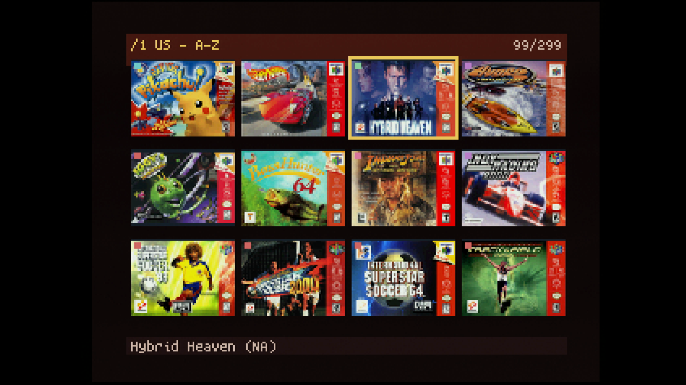
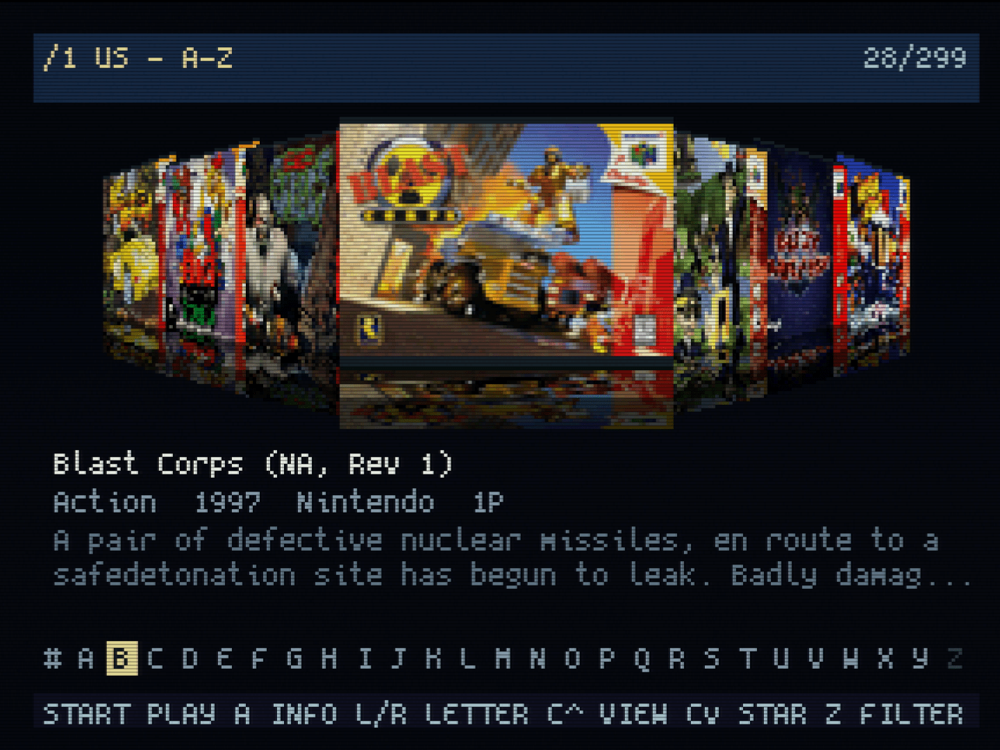
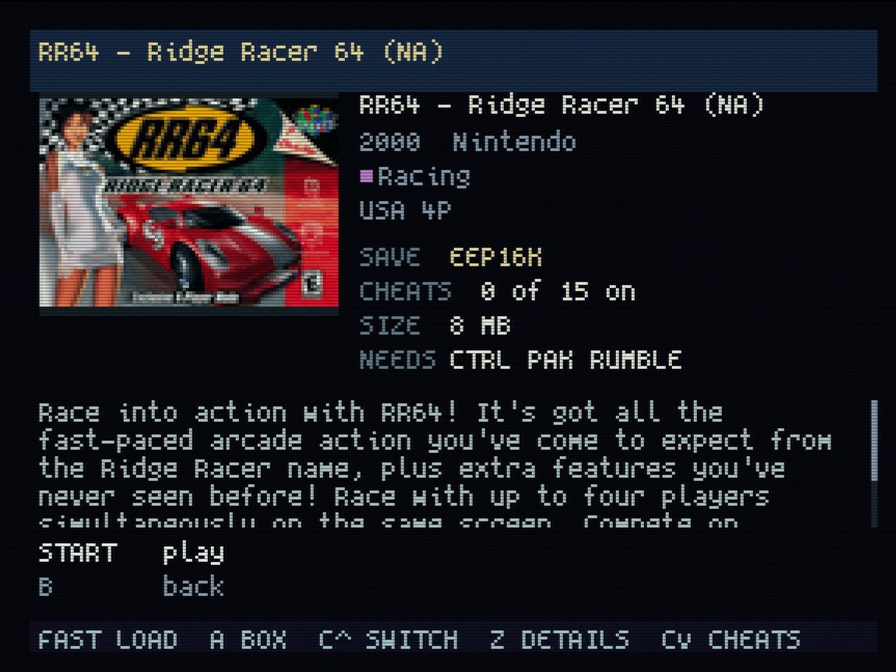

<p align="center">
  
</p>
<p align="center">
  <a href="https://www.buymeacoffee.com/CathodeJay"></a>
</p>

---

A game browser for the EverDrive-64 X7 and Pro: box art, genres,
descriptions and filters for your N64 library, and the game you pick boots
straight from it. It is an ordinary ROM on the card, started from the
EverDrive's own menu, which stays where it is; saves go to the same
`ED64/gamedata/` folder, so a game carries its save between the two menus.
The console can also start straight in it, on the X7 and on the Pro.



## Install

You need an EverDrive-64 X7 (OS 3.11) or Pro with your ROMs on the card, in
any folders you like, and a Mac, a Windows PC or a Linux computer. Nothing
to install.

**1. Download the Game Catalog Manager for your computer** from the
[releases page](https://github.com/CathodeJay/sleekmenu64/releases/latest).

| Your computer | The Game Catalog Manager |
|---|---|
| Mac with Apple silicon (M1 and later) | `SleekMenu-Catalog-Manager-mac-arm64.zip` |
| Mac with an Intel processor | `SleekMenu-Catalog-Manager-mac-intel.zip` |
| Windows | `SleekMenu-Catalog-Manager-windows.exe` |
| Linux | `SleekMenu-Catalog-Manager-linux` |

**2. Open it.** On a Mac, unzip it first. It is not code-signed, so the
first launch warns. On macOS 15 and later, open it once, then press Open
Anyway in System Settings → Privacy & Security (earlier macOS: right-click
→ Open). On Windows: More info → Run anyway. On Linux: `chmod +x
SleekMenu-Catalog-Manager-linux` first.

**3. Set up the card.** It is picked for you when it is the only removable
disk. Press **Set up card**: it puts `SleekMenu64.z64` at the root of the
card, fetches a box and a description for each of your games, then writes
the catalog. Up to about 330 MB for a complete library, once; you can stop
and carry on later. (On a computer without internet, download
`SleekMenu64.z64` from the same page and copy it to the root of the card
yourself.)

**4. Put the card back in the cart and start `SleekMenu64.z64` from the
EverDrive menu.** Start plays a game,
A shows its details; reset the console to get back to the EverDrive menu.

**Adding games later:** copy them on, open the Game Catalog Manager, press
**Update card**. Only what changed is read and only the new games' boxes
are fetched. Until then a new game still shows up and plays, just without
its box.

**A new release:** the Game Catalog Manager says when one is out, with the
download for your computer. Open the new one and press **Update card**: it
puts the SleekMenu of the same release on the card. The two always go
together, so a card is never left with a SleekMenu its catalog does not
suit.

**Starting the console in SleekMenu:** the X7 and the Pro can both power
on straight into it; see [below](#starting-the-console-in-sleekmenu).

**Themes:** the browser comes in ten sets of colours: Midnight, Charcoal,
the six Funtastic colours (Jungle, Grape, Fire, Ice, Smoke, Watermelon),
Atomic Purple and Gold. Change it on the console (Z, then the THEME row)
or under **Theme** on the Game Catalog Manager's Card tab.

**Music:** choose a song under **Theme** on the Game Catalog Manager's
Card tab (MP3, WAV, FLAC or OGG) and SleekMenu plays it on a loop while
you browse. It fades out when a game starts. Turn it on or off on the
console with Z, then the MUSIC row.

The Game Catalog Manager also shows your card the way the console will, and
lets you give any game your own picture, description or facts; see
[docs/PREP.md](docs/PREP.md).


Descriptions come from the
community-maintained
[n64-flashcart-menu-metadata](https://github.com/n64-tools/n64-flashcart-menu-metadata)
collection, boxes and, when you ask for them, screenshots from
[libretro-thumbnails](https://github.com/libretro-thumbnails/Nintendo_-_Nintendo_64),
and, when you ask for them, cheat codes from
[libretro-database](https://github.com/libretro/libretro-database);
SleekMenu ships none of them.

## Using it

| Control | Browsing | A game's details |
|---|---|---|
| D-pad / stick | Move; hold to keep moving, faster and then several games at a time the longer you hold. The stick leaned part way moves one game at a time | Up and down scroll the description; left and right go to the previous or next game |
| A | Open a folder, or a game's details | The box, full screen; left and right turn to the screenshots |
| B | Parent folder | Back to the list |
| Start | Play | Play |
| C-left / C-right | Previous / next genre tab | — |
| C-up | List, grid or coverflow | Fast or verified load |
| C-down | Favourite | Cheats |
| L / R | Page up / down (coverflow: previous / next letter) | — |
| Z | Filters, theme and music | Diagnostics |

The bar along the bottom of every screen says what the buttons do there,
each button drawn in its own colour: a blue A, a green B, a red Start, the
yellow C buttons with their arrow.

The first two tabs are your favourites and the last fifteen games you
played. The **grid** shows twelve covers at a time; **coverflow** shows one
face on, with the facts, the start of the description and a strip of
initials under the shelf.







## Starting the console in SleekMenu

The console can power on straight into SleekMenu, without a stop in the
EverDrive menu. Each EverDrive starts a file in the card's `ED64` folder by
itself when there is one, so SleekMenu only has to be that file:

| EverDrive | The file | What changes |
|---|---|---|
| X7 (a recent OS; 3.11 has it) | `ED64/autoexec.v64` | A reset inside a game returns to the EverDrive menu, where `SleekMenu64.z64` is still at the card root. |
| Pro (firmware 26.1014 or newer) | `ED64/menu.n64` | SleekMenu replaces the Pro's menu: games started from it have no in-game menu or save states. |

Two ways to put it there:

- **With the Game Catalog Manager:** tick **Start the console in
  SleekMenu** on the Card tab and press Update card. It makes the right
  copy for your EverDrive and keeps it up to date when SleekMenu is
  updated.
- **By hand:** copy `SleekMenu64.z64` into the card's `ED64` folder and
  rename the copy as in the table. Only the name changes; nothing is
  converted. Do it again when you install a newer SleekMenu.

To go back, untick the box and update, or delete the file. More in
[docs/CONSOLE.md](docs/CONSOLE.md#starting-the-console-in-sleekmenu).

## Good to know

- **On the Pro,** let the console boot once after playing before you pull
  the card: that is when the cartridge writes the save out.
- **Hacks** that black-screen on a console because of a stale header
  checksum are fixed as they launch.
- **Hacks, translations and homebrew** are told apart from retail games by
  their name, their folder and the database, and tagged HACK, TL or HB on
  their row; Z filters by kind. A wrong guess is corrected in the Game
  Catalog Manager.
- **Screenshots:** tick **Download screenshots** on the Game Catalog Manager's
  Card tab and each retail game gets its title screen and a moment of play:
  two thumbnails beside the facts on its details, and full size in the box
  view, after the box. Add your own for a hack from the Games tab.
- **Cheats** come from the EverDrive-64 Pro's cheat pack in `ED64/CHEATS/`,
  or from libretro when you tick **Download cheat codes** on the Game Catalog
  Manager's Card tab, and need an Expansion Pak.
- **`.z64` and `.v64`** dumps load; `.n64` ones do not — convert them first.

Everything else about the console — the screens, saves, the clock, 64DD,
cheats in detail — is in [docs/CONSOLE.md](docs/CONSOLE.md).

## More

- [docs/PREP.md](docs/PREP.md) — the Game Catalog Manager in full, your own
  art and text, high-resolution boxes, screenshots, cheat codes, and the
  command line
- [docs/CONSOLE.md](docs/CONSOLE.md) — using SleekMenu on the console
- [docs/CARD_LAYOUT.md](docs/CARD_LAYOUT.md) — every file on the card
- [docs/DESIGN.md](docs/DESIGN.md) — how it is put together and why
- [CHANGELOG.md](CHANGELOG.md) — what changed in each release

## Building from source

Needs a [libdragon](https://github.com/DragonMinded/libdragon) toolchain.

```sh
make test                                   # host-side tests, no hardware needed
make slim N64_INST=/path/to/libdragon       # build/release/SleekMenu64.z64
make prep                                   # the Game Catalog Manager, as a .pyz
make perf N64_INST=/path/to/libdragon       # the ROM with a frame-time readout
```

`make help` lists the rest.

## Support

SleekMenu 64 is free. If it earned a place on your card and you would like
to support its development, you can
[buy me a coffee](https://buymeacoffee.com/CathodeJay).

## AI

Yes, this project was built with AI tools.

## Licence

AGPL-3.0-only. The boot handoff is vendored from
[N64FlashcartMenu](https://github.com/Polprzewodnikowy/N64FlashcartMenu)
(AGPL), the EverDrive-64 Pro cartridge library from
[krikzz](https://github.com/krikzz/ed64-pro-pub) (MIT) and the interface
font is [Spleen](https://github.com/fcambus/spleen) (BSD-2-Clause); `data/`
is CC BY-SA 4.0 and `src/rom_db.c` is ISC. No box art is included.
[NOTICE.md](NOTICE.md) has the full map.
