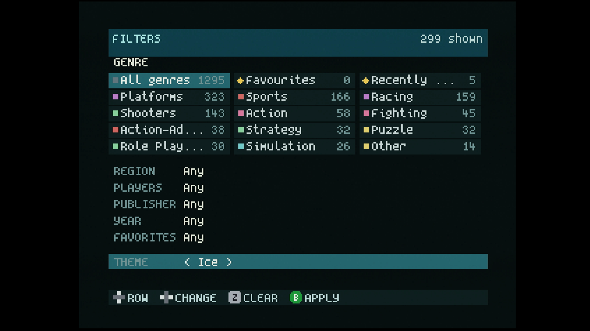

# On the console

What SleekMenu does once it is running. The controls are in the
[README](../README.md#using-it).

## Hacks, translations and homebrew

A game that is not a retail cartridge says so: **HACK**, **TL** (a
translation) or **HB** (homebrew) at the end of its row, and the word
beside its genre on its details. The KIND row of the filter page shows one
kind only. The Game Catalog Manager works out what each game is from its
file name ("(Hack)", "[T+Eng]", "(PD)"), the folder it is in ("Hacks",
"Translations", "Homebrew") when it says, and what the database knows of
the game it was built on; a wrong guess is corrected in its Games tab
([PREP.md](PREP.md#hacks-translations-and-homebrew)).

## Moving

The D-pad and the stick move the same way. Held, a direction keeps moving,
faster the longer it is held; after three seconds it moves five games a
step, after six twenty, so the far end of a 3,000-game library is about
fifteen seconds away. The stick leaned only part of the way keeps to one
game at a time at an even pace, for stopping on the one you want; lean it
all the way to speed up. In the grid, a long hold up or down moves whole
rows.

## The screens

C-up cycles the three views. The **list** is for a game you can name: the
current folder on the left, the box and the facts of the highlighted game on
the right, and the genre tabs across the top.

The **grid** shows twelve covers at a time, for scanning a folder by eye.


**Coverflow** shows one game face on with its neighbours receding either
side, gliding as you move; hold a direction and the shelf keeps sliding.
Under it are the title, the genre, year, publisher and players, the start
of the description (the rest creeps into view if you stay on a game for
five seconds), and a strip of initials showing where you are. L and R
jump to the next letter of the alphabet instead of paging.


**The details**: A on a game. The box, the year, publisher, genre, region
and players, the save type, how many cheats are on, the size and what the
game needs (a Controller Pak, a Rumble Pak), then the description, which
scrolls. A game with [screenshots](#screenshots) shows them as two small
pictures at the right of the facts. Left and right go to the previous or
next game in the list, round from the last to the first: the title and the
facts are up at once, and the box, the save type and the size follow when
you stop. B goes back to the list on the game you ended on. Start plays;
C-up switches between a fast and a verified load; C-down opens the cheats;
Z shows the diagnostics.


**The box**, full screen: A on a game's details. It is drawn from
`covers-large.pak`, which the tool writes beside the small pack: the
collection's scan uncropped at its own size, or, after `--hires`, the
512-pixel box fitted to the screen. B goes back; Start still plays. For a
game with screenshots, left and right turn to them.

Z opens the **filter** from any view: genre (with a count for each), region,
players, publisher, year, favourites and kind, combined. Z again clears it,
B applies it. The header shows how many games match. The last two rows of
the page are not filters: they are the [theme](#themes) and the
[music](#music).



The bar along the bottom of every screen says what the buttons do on that
screen. Each button is a small picture in the colour it has on the
controller: a blue A, a green B, a red Start with an S, the yellow C
buttons with their arrow, grey Z, L and R, and a cross for the D-pad.

## Screenshots

When the Game Catalog Manager fetched them, or you gave a game your own
([PREP.md](PREP.md#screenshots)), a game has two screenshots: its title
screen and a moment of play. The details show both as thumbnails at the
right of the facts, the title screen above; the facts beside them are cut
a little shorter, and the box and the description stay where they are. In
the box view, left and right turn from the box to the title screen and to
the game in play, then round to the box again; the title band names the
pictures the game has and lights the one on screen. Each picture is read
from the card as it is turned to.

A game without screenshots looks as it always did. They come from
`shots.pak` and `shots-large.pak`; a card without them, or a SleekMenu from
before them, simply has none.

## Themes

The colours are a theme: Midnight, Charcoal, Jungle, Grape, Fire, Ice,
Smoke, Watermelon, Atomic Purple and Gold. Midnight is the default. To change it, press Z and go to the **THEME** row
under the filters (up twice from the top row gets there): left and right
step through the themes, and the screen takes each one as you do. B keeps
the choice, on the card in `sleekmenu/theme.txt`, and the browser starts in
it from then on. The Game Catalog Manager sets the same file
([PREP.md](PREP.md#themes)). The buttons' colours, the favourite star, a
warning and an error are the same in every theme.

In the grid and in coverflow, where the genre tabs are not shown, the
title bar names the genre you are in, spelled out.

## Music

SleekMenu can play a song on a loop while you browse. Choose it in the Game
Catalog Manager ([PREP.md](PREP.md#music)), which puts it on the card as
`sleekmenu/music.wav64`. The music starts once the list is up and fades out
when you start a game. If the game doesn't start, it picks up where it left
off.

To turn it off, press Z and go to the **MUSIC** row, the last one (up from
the top row gets there at once): left or right turns it on or off, and you
hear the change right away. B keeps the choice in `sleekmenu/music.txt`.
The row says **None** when the card has no song. Choosing a new song in the
Game Catalog Manager turns the music back on.

## Starting the console in SleekMenu

**EverDrive-64 X7.** The stock OS starts a file by itself at power-on when
the card has one: `ED64/autoexec.v64`. SleekMenu only has to be that file.
The Game Catalog Manager makes it so: tick **Start the console in
SleekMenu** on its Card tab and press Update card
([PREP.md](PREP.md#starting-the-console-in-sleekmenu)). By hand it is a
copy of `SleekMenu64.z64` in the `ED64` folder, renamed `autoexec.v64`;
nothing is converted. From then on:

| You do | You land in |
|---|---|
| Power on | SleekMenu |
| Reset while in SleekMenu | SleekMenu |
| Reset while in a game | the EverDrive menu |

The EverDrive OS still starts first, briefly: it writes the last game's
save to the card, then hands over. Nothing about saves changes. A reset inside a game shows the EverDrive menu because
the OS only starts the file again when the file was the last thing it
launched; `SleekMenu64.z64` is still at the card root to pick from there,
and the next power-on is SleekMenu again. To go back for good, untick the
switch and update the card, or delete `ED64/autoexec.v64`.

**EverDrive-64 Pro.** Firmware 26.1014 and newer start `ED64/menu.n64` in
place of the Pro's own menu. The same switch in the Game Catalog Manager
puts SleekMenu there, or by hand it is a copy of `SleekMenu64.z64` in the
`ED64` folder, renamed `menu.n64`. SleekMenu is then the cartridge's menu:
the console powers on in it, and the cartridge still writes the last
game's save to the card at power-on. What the Pro's menu brings with it is
gone while SleekMenu replaces it: games started from SleekMenu have no
in-game menu and no save states. To have the Pro's menu again, untick the
switch and update the card, or delete `ED64/menu.n64`.

Without it, the console powers on in the Pro's menu. Start there opens
Recently played, where SleekMenu stays first: games started from SleekMenu
are not added to that list.

## Saves

Written to `ED64/gamedata/` under the EverDrive's own file names. On the X7
the save is moved to the card the next time a menu boots. On the Pro the
cartridge handles saves itself and writes them out at the next power-on,
whichever menu comes up — so after playing, let the console boot once
before pulling the card.

## Clock

A game that keeps time (Animal Forest) gets the cartridge's clock as it does
from the stock menu: set at launch on the X7, served by the cartridge on the
Pro.

## Hacks and homebrew

A hack whose author never recomputed the header checksum runs in an emulator
and black-screens on a console. SleekMenu corrects the checksum in cartridge
memory as it launches, the way the EverDrive menu does; the Game Catalog
Manager checks every hack, translation and homebrew on the card, names the
ones whose checksum is stale, and rewrites them if you tick "Repair hacks
that show a black screen on a console" in the window (`--fix-checksums` on
the command line).

## ROM formats

`.z64` and `.v64` (byteswapped) dumps load; `.n64` word-swapped dumps are
listed but refused, convert them to `.z64`. Size limit: 64 MiB on the X7,
126 MiB on the Pro.

## 64DD on the Pro

`.ndd` disk images are listed like games. Selected on their own they boot
from the drive's IPL, which the Pro's menu keeps in `ED64/64ddipl/`; a
`.ndd` in the same folder as a cartridge ROM is attached to that ROM as its
expansion disk. Experimental: not yet run on hardware.

## Games added after the last update

The browser reads the folder it is in off the card and lists anything the
catalog does not know — a game you copied on last night, a folder of them —
where its name sorts, under its file name, with an outline where the genre
chip would be and `NOT IN CATALOG` where the box would be. It plays like any
other; the status line says how many are waiting, and the next update gives
them their boxes and facts. Only the folders the browser shows are read:
with the whole library under one folder, a new folder beside it at the card
root is not seen until the card is prepared again. A new folder is only
listed if there is something to play in it: an empty folder, or one with
only Controller Pak files, is left out. A ROM-shaped file the tool set
aside as not a ROM is known to the browser and never listed.

## Not done yet

Controller Pak (`.mpk`) backup and restore.

## Cheats

GameShark codes, from two places. The EverDrive-64 Pro's menu ships a
cheat pack in `ED64/CHEATS/` (one `.cht` file per game): if that folder is
on your card, there is nothing to set up. And the Game Catalog Manager
fetches libretro's file for each of your games when you tick **Fetch cheat
codes** ([PREP.md](PREP.md#cheat-codes)); those are filed by the exact
dump, and serve the games the pack has no file for, or none for your
region. Where the pack has the game for your cartridge's region, its
shorter list is the one used.

**To use them:** open a game's details, press C-down, tick the codes you
want, press B. Your choices are remembered per game in
`sleekmenu/cheats.txt`. Cheats need an Expansion Pak.

**Which file a game gets.** The pack names its files with short region tags
— `F-Zero X (U).cht`, `F-Zero X (E).cht` — while ROMs are usually named
`F-Zero X (USA).z64`. SleekMenu matches on the game's name and on the
region written inside the ROM, so a USA cartridge gets the `(U)` file and
never European codes. The cheats page shows the file it picked, and warns
when it had to guess.

**When there is nothing to tick:**

- *"Cheat pack has this game for Europe, Japan; yours is USA"* — the pack
  has no file for your region. Codes from another region point at the wrong
  memory addresses and do nothing, so they are not offered.
- *"Not in the cheat pack"* — the pack has files for some 540 games, most
  of the well-known ones, far from all. Fetching libretro's files covers
  more.
- *"WILL NOT RUN"* in red on the card — the console has no Expansion Pak, or
  the game's boot code is not the retail one (hacks, homebrew). The cheats
  page says which.

**Your own codes.** Put a `.cht` file in `sleekmenu/cheats/`, named exactly
like the ROM file (`Super Mario 64 (USA).cht` for `Super Mario 64 (USA).z64`).
It is used instead of a fetched file and of the pack. The format is the pack's own; a cheat made
of several lines of code joins them with `;`:

```text
cheats = 2
cheat0_desc = "Infinite Lives"
cheat0_code = "8033B21D 0064"
cheat1_desc = "99 Coins"
cheat1_code = "8133B218 0063"
```
